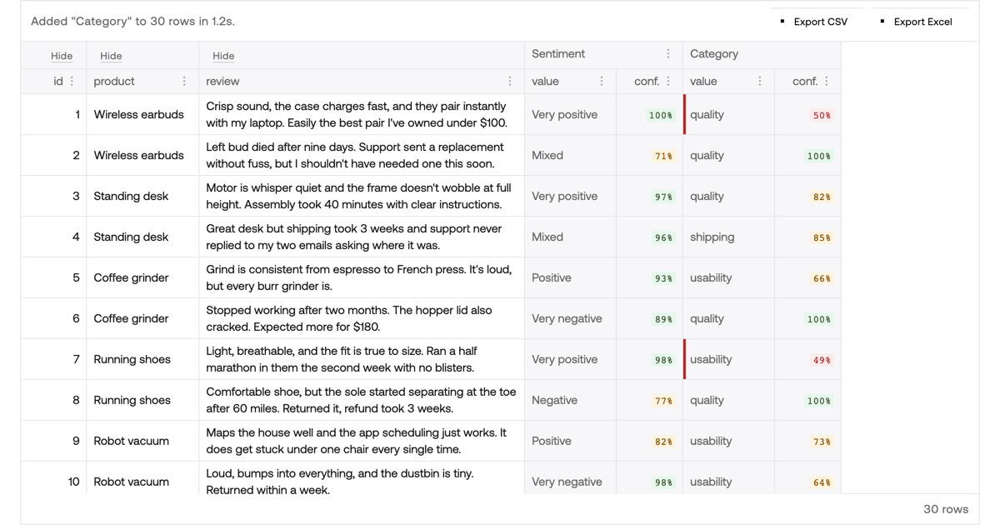

# JevSheet: Spreadsheet Enricher

**Classify spreadsheet rows with Jev, and know which answers to trust.**

Upload a CSV or Excel file, describe a new column in plain English, and every row gets an answer plus a calibrated confidence. Sort by confidence and you only check the rows that need a person. Built with [Handsontable](https://handsontable.com/?utm_source=github&utm_medium=referral&utm_campaign=ai-columns-jev) and [Jev](https://typesafe.ai/), TypeSafe AI's decision model.

**[Try the live demo](https://demos.handsontable.com/d/2g6f4hc3b2/?utm_source=github&utm_medium=referral&utm_campaign=ai-columns-jev)** · [Read the step-by-step recipe](https://handsontable.com/docs/javascript-data-grid/recipes/real-time/ai-columns-jev/?utm_source=github&utm_medium=referral&utm_campaign=ai-columns-jev) · [Get Handsontable](https://handsontable.com/pricing/?utm_source=github&utm_medium=referral&utm_campaign=ai-columns-jev)



## What it does

Most "AI in a spreadsheet" tools paste a chatbot into a cell. You get prose to parse, and a wrong answer sounds exactly as sure as a right one. Jev answers typed questions instead, and says how sure it is:

| Type | Answer | Example prompt |
|---|---|---|
| Noul | the probability of "yes", 0 to 1 | Does this review warrant a reply from customer support? |
| Score | one of the ordered levels you name | How positive is this review? (Very negative … Very positive) |
| Choice | one of the options you list | Which category fits the main issue? (quality, shipping, price, support, usability) |

Score and Choice answers come with a confidence, a real probability you can sort and filter on. In the grid, a low answer gets a red review edge, so the ambiguous rows find you.

- **Any list of text:** reviews, support tickets, leads, survey answers.
- **Formulas survive:** upload an `.xlsx` and its formulas keep working, recalculated by HyperFormula. Jev reads the calculated values, and the Excel export writes the formulas back out.
- **Hide what Jev doesn't need:** a hidden column never leaves the browser.
- **Export:** CSV or Excel, with every answer and its confidence as columns.

The live demo is free and classifies up to 50 rows per column. For more, run your own copy (below) with your own Jev key.

## How it's built

```
demo/                    the app (Vite, vanilla JS)
  index.html, index.js   two Handsontable grids, import/export, live vs recorded mode, the fill sequence
  style.css              the handsontable.com design system's tokens
  sample-data.js         30 sample product reviews
  recorded.js            Jev's answers for the sample, so embeds replay without calling Jev
  vite.config.js         local dev: proxies /api to the Worker
src/worker.js            Cloudflare Worker: POST /api/classify, holds the Jev key
public/og.png            the share image
wrangler.jsonc           Worker config: allowed origins, rate limit, required secret
```

- **The front end** is two Handsontable grids. The top one defines a column (name, prompt, type, options). The bottom one holds the data. Adding a column sends one request per row, eight at a time, and writes each answer into its cell as it lands. Answers are written by physical row, so sorting mid-run can't misplace them.
- **The Worker** validates the request, asks Jev one question, and returns `{ value, confidence }`. The Jev key never reaches the browser.
- **The published demo** runs on [demos.handsontable.com](https://demos.handsontable.com/), Handsontable's demo runner. The page picks its mode from its own URL. `/d/<id>/` and localhost classify live. The `/embed/<id>/` iframe and the editable playground replay `recorded.js` and make no network calls.

## Run it yourself

You need Node 22, a [Jev API key](https://console.typesafe.ai/) (Jev is in early access), and, to deploy, a Cloudflare account.

```bash
cp .env.example .env    # put your Jev key in JEV_API_KEY; .env is git-ignored
```

```bash
npx wrangler dev --port 8787 --var ALLOWED_ORIGINS:http://localhost:8080
```

```bash
npm --prefix demo ci && npm --prefix demo run dev
```

Open http://localhost:8080 for the live mode, or http://localhost:8080/?recorded for the replay mode.

To deploy your own copy:

1. In `wrangler.jsonc`, change `name` and `account_id` to yours, set `ALLOWED_ORIGINS` to the origin your page is served from, and point `DEMO_URL` at your page.
2. In `demo/index.js`, point `CLASSIFIER_URL` at your Worker and adjust the `LIVE` rule to your host. Raise `MAX_ROWS_PER_COLUMN` there for bigger files, and the rate limit in `wrangler.jsonc` with it.
3. `npx wrangler deploy --secrets-file .env` deploys the Worker with the key as a secret, and `npm --prefix demo run build` gives you a static `demo/dist/` to host anywhere.

## Security

- The Jev key exists only as a Worker secret, pushed from a git-ignored `.env`. It is never sent to the browser or committed.
- `/api/classify` answers only pages on allowed origins (CORS for the others), limits each IP to 300 requests a minute, caps prompt, option and row sizes, and never echoes the input or forwards Jev's error bodies.
- Nothing is logged or stored: Workers logs are off and there is no database.
- An origin check stops other websites, not scripts. The rate limit bounds what a script can spend. An app with accounts should put the endpoint behind its own auth.
- `npm audit` reports a moderate advisory in `uuid`, pulled in by ExcelJS. It only applies when a caller passes its own buffer, and ExcelJS never does, so it isn't reachable here.

Found a vulnerability? Please report it privately through [handsontable.com/contact](https://handsontable.com/contact/), not in a public issue.

## The `/api/classify` contract

Request:

```json
{ "type": "noul" | "score" | "choice", "prompt": "string", "options": ["..."], "row": { "col": "value" } }
```

- `options` is required for `choice` (2 to 255 names) and optional for `score` (2 to 10 ordered level labels, low to high). When omitted the Worker falls back to `Very low, Low, Medium, High, Very high`; the front end always sends explicit levels and shows that fallback in the config row. It is ignored for `noul`.
- `row` must be a flat object of strings, numbers, booleans or nulls, at most 4 KB serialized.

Response: `{ "value": ..., "confidence": 0..1 }` (Score answers also carry `"label"`; the grid shows the label and keeps the score in the cell tooltip)

| type | value | confidence |
|---|---|---|
| noul | `p`, Jev's probability of "yes", 0 to 1 | `|2p - 1|` (0 at 50/50, 1 at either extreme) |
| score | `score / (levels - 1)`, so 0 to 1, plus `label`: the most likely level's name | Jev's confidence |
| choice | the chosen option | Jev's confidence |

Errors are `{ "error": "message" }` with 400 (bad shape), 403 (wrong origin), 405, 429 (caller or Jev rate limit), 502/503 (upstream). The input is never echoed back.

## Grid details

- **Config grid:** Type is a Handsontable `select` cell drawn with the theme's dropdown arrow; selecting the cell opens the list immediately.
- **Data grid:** sortable, filterable, resizable, every cell vertically centered. Numeric columns right-align and autosize; long-text columns wrap at 391px; `id` and `product` have preset widths. Added columns autosize once their values land.
- **Import:** CSV via PapaParse, or `.xlsx` via ExcelJS. Row 1 becomes the headers and formulas are kept as formulas; the sheet is run through a throwaway HyperFormula instance that deletes row 1 so every reference shifts correctly. Handsontable's own `ImportFile` plugin arrives in 19.0 and can replace this reader.
- **Export:** CSV or Excel through the ExportFile plugin; Excel export writes formulas as formulas.
- **Known limitation:** sorting or filtering a grid that contains aggregate formulas such as `=SUM(D1:D30)` can corrupt those cells (the Formulas plugin works on visual indexes). Per-row formulas like `=LEN(C1)` are safe.
- Only the original file columns are sent to Jev for each row, minus any you hide, never the AI columns already added.

## License

The code in this repository is [MIT](LICENSE). The libraries it uses have their own terms:

- **Handsontable** is commercial software. The demo runs on the `non-commercial-and-evaluation` key; production use needs a [Handsontable license](https://handsontable.com/pricing/?utm_source=github&utm_medium=referral&utm_campaign=ai-columns-jev).
- **HyperFormula** is used under GPLv3 (the `gpl-v3` key). A commercial license is available from Handsontable.
- **Jev** is a TypeSafe AI service, used under [their terms](https://typesafe.ai/).
